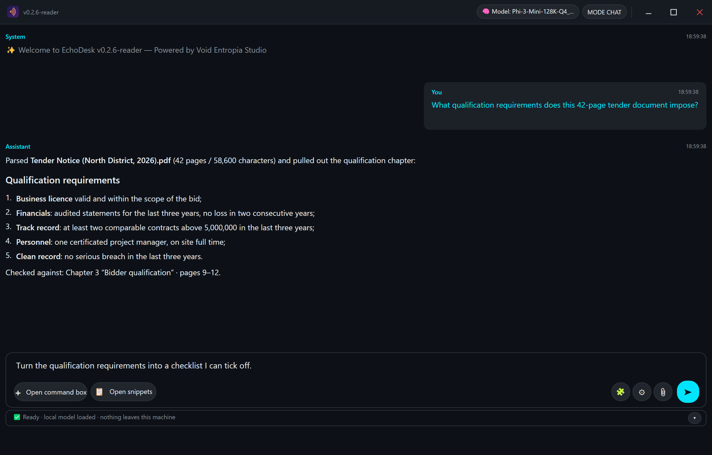
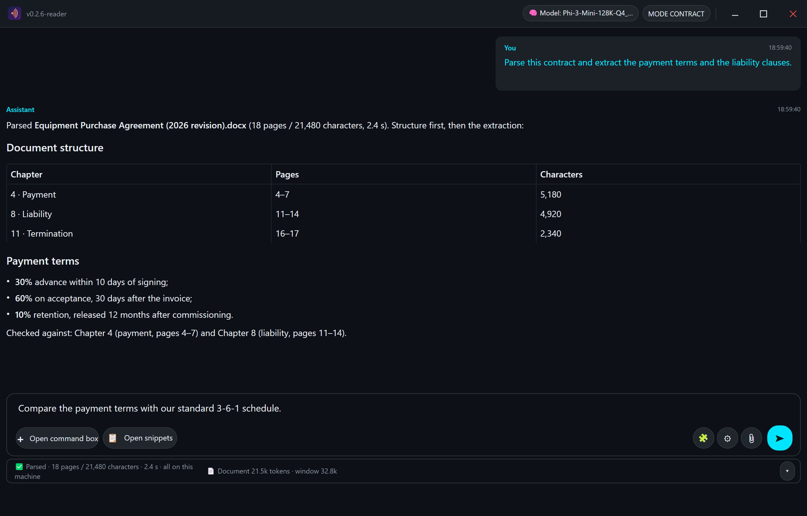
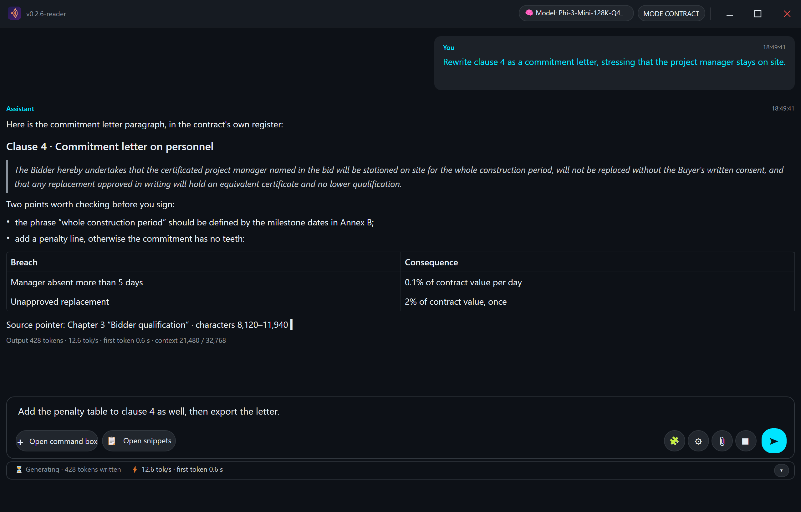

# EchoDesk Reader

> **Version 0.2.6-reader.** This branch publishes the Reader edition: the v0.2.6 code base with the
> browser-automation, multimodal and retrieval stacks removed, tuned for reading and analysing long
> local documents. Every user-facing statement below is true of **this** build; the parts that are
> gone are listed explicitly in [What this edition leaves out](#what-this-edition-leaves-out).



**A local-first AI assistant for reading and analysing your own documents — no cloud, no account,
no telemetry.**

EchoDesk Reader keeps the whole stack on your machine: the model runs locally through llama.cpp, the
documents are parsed locally, and the conversation history never leaves the disk. It is built for
people who cannot send their contracts and reports to a cloud AI service — compliance-bound teams,
isolated networks, and anyone who simply wants their files to stay put.

[中文说明 →](README.zh-Hans.md)

| Reading a parsed document | Streaming a contract rewrite |
| :---: | :---: |
|  |  |

- **Platform**: Windows 10/11 (x64) first; the same Avalonia front end builds and runs on macOS and
  Linux. The WPF front end is still in the tree for the Windows LTS line but is **not** part of the
  Reader build.
- **Inference**: local GGUF models through llama.cpp (`llama-cpp-python`), CPU by default
- **Model profile**: tuned for Phi-3-Mini-128K — its 128K window is the ceiling the document
  allocation is bounded by; any GGUF model still loads
- **KV cache**: quantised to 8-bit (`Q8_0`) instead of F16, which roughly halves the cache footprint
  at the same window
- **Interface**: Avalonia (C#) desktop app, packaged Python 3.13 backend
- **Languages**: Simplified Chinese and English
- **License**: [Apache-2.0](LICENSE)

## Dynamic context, the reason this edition exists

The Reader build allocates the context window **from the document instead of from a fixed
setting**: once a file is parsed, the window is planned as

```
file tokens + 4096 (answer budget) + 512 (safety margin)
```

clamped to `[initial context, 131072]`, and the model is reloaded only when the window has to grow.
Within one process the window never shrinks, so adding a second, smaller document does not pay for
another model load. A document whose token count cannot fit even at the 128K ceiling is **refused
with an explanation rather than silently truncated** — you always know why a file was not accepted.

## What this edition leaves out

These were part of v0.2.6 upstream and are **removed from this build**, along with their settings
pages, tests and packaging steps:

| Removed | What it used to do |
| --- | --- |
| Browser automation | Playwright-driven batch review of web task lists (selector picker, safety protocol, result files) |
| Multimodal | Local vision (VLM), speech capture/transcription, media path handling |
| Retrieval stack | SQLite FTS5 knowledge base, long-term memory, BM25 retrieval and the extractive summariser |

The `tools/verify_release.ps1` gate on this branch asserts that no residue of those modules is
imported or packaged, instead of checking them.

## Quick start

### Portable build (no installer needed)

1. Unpack the whole `EchoDesk-Reader-v0.2.6-reader` folder anywhere you like — nothing is written
   outside it, and deleting the folder uninstalls it.
2. Double-click **`app\EchoDesk.exe`**. It starts the backend next to it by itself; never run
   `app\backend\EchoDeskBackend.exe` on its own, it only speaks the JSON-lines protocol.
3. On first start it offers to download a model. You can also drop a `.gguf` file into
   `app\backend\models\` yourself and pick it under **Settings → Model**.

The layout is:

| Path | What it is |
| --- | --- |
| `README.md`, `LICENSE`, `NOTICE` | This document and the licences |
| `app\EchoDesk.exe` | Avalonia front end; the UI language packs are embedded in it |
| `app\backend\EchoDeskBackend.exe` | Packaged Python backend (PyInstaller onedir) |
| `app\backend\lang\` | Backend language packs (messages, errors, command help) |
| `app\backend\config.json` | All configuration |
| `app\backend\models\` | Local `.gguf` models |
| `app\backend\session.json` | Conversation history (auto-saved and restored) |

The optional `-MakeInstaller` step produces `EchoDesk-Reader-v0.2.6-Setup.exe`, which installs the same
layout.

Set the `ECHODESK_DATA` environment variable to move the outer data folder elsewhere (useful on
managed machines where the program folder is read-only).

### From source

```
python -m venv .venv
.venv\Scripts\python -m pip install -r backend\requirements.lock
dotnet run --project frontend-avalonia\EchoDesk.Avalonia\EchoDesk.Avalonia.csproj
```

The front end launches the backend itself. To exercise the protocol alone, run
`python backend\main.py` **with `backend\` as the working directory** (the backend resolves `models/`
and the skill directory against it), and type one JSON request per line. On macOS/Linux use
`python3` and `.venv/bin/python`. `tools/build_reader.ps1` produces the Windows portable folder and,
with `-MakeInstaller`, the Inno Setup package.

## Documents it reads

`.docx`, `.xlsx`, `.xlsm`, `.xls`, `.pptx`, `.pdf`, `.txt`, `.md`, `.csv` and similar plain-text
formats. Legacy `.doc` / `.ppt` and encrypted files are read through WPS/Office COM on Windows; if
WPS/Office is absent, the built-in parsers handle the modern formats and the legacy ones are
reported as unavailable instead of failing silently.

Long documents are **read whole rather than compressed**: the window is grown to fit the document
(see [Dynamic context](#dynamic-context-the-reason-this-edition-exists)) and the parsed body goes to
the model in one pass. There is deliberately no chunk-by-chunk summarisation on this branch — that
pipeline needed a small model to compress the material, and compressing it was exactly what made
answers about specific clauses unreliable. A document that cannot fit even at the ceiling is refused
with an explanation, so nothing is silently dropped.

## Privacy and networking

- No telemetry, no account, no listening port. Nothing about your documents leaves the machine
  unless you start a networked feature yourself.
- **Off by default**: web search, model download, update check. When you enable search, only the
  keywords of the current question are sent.
- External model providers are opt-in and gated behind an explicit consent checkbox: the moment
  data would leave the machine, the program says so and asks first.

## Documentation

- [`docs/en/USER_GUIDE.md`](docs/en/USER_GUIDE.md) — hands-on guide, including the Reader edition
  scope note.
- [`docs/en/FAQ.md`](docs/en/FAQ.md) — quick start and troubleshooting.
- [`docs/en/CROSS_PLATFORM.md`](docs/en/CROSS_PLATFORM.md) — what differs per platform.
- [`CHANGELOG.md`](CHANGELOG.md) — release history.
- [`SECURITY.md`](SECURITY.md) — how to report a vulnerability privately.
- [`docs/images/`](docs/images/) — the screenshots embedded above; regeneration steps are in
  [`docs/en/DEVELOPER.md`](docs/en/DEVELOPER.md).

## Getting help and contributing

Contributions are welcome — bug reports, fixes, skills, translations and documentation alike.
Every public channel is on GitHub; the project publishes **no support email address, no phone
number and no postal address**.

- **Report a problem or request a feature** — open a GitHub Issue:
  <https://github.com/wyx-spark/EchoDesk/issues>. Include your version, operating system, exact
  steps and the relevant log.
- **Ask a question or share an idea** — start a thread in
  [GitHub Discussions](https://github.com/wyx-spark/EchoDesk/discussions).
- **Send a change** — open a pull request; [CONTRIBUTING.md](CONTRIBUTING.md) covers the
  development environment, code style, commit conventions and the review flow.
- **Security problems** — please do **not** open a public issue; follow the private reporting
  process in [SECURITY.md](SECURITY.md) instead.
- **Community behaviour** — [CODE_OF_CONDUCT.md](CODE_OF_CONDUCT.md).

## Organization

[Void-Entropia-Studio](https://github.com/Void-Entropia-Studio). EchoDesk is an independent project
and is not affiliated with any other product using the same or a similar name.
