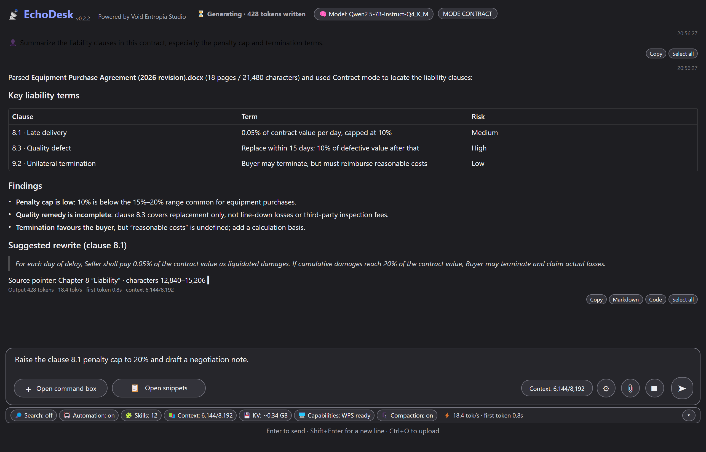
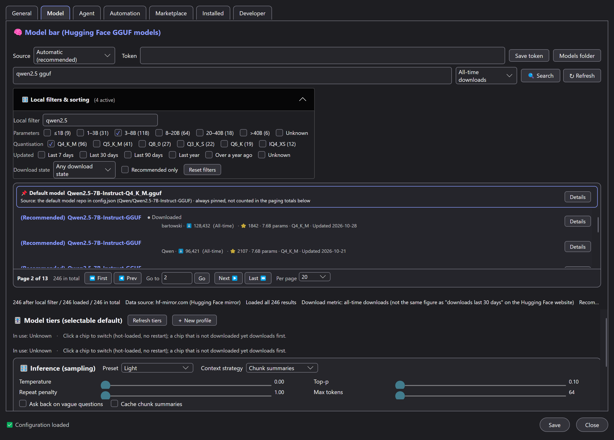
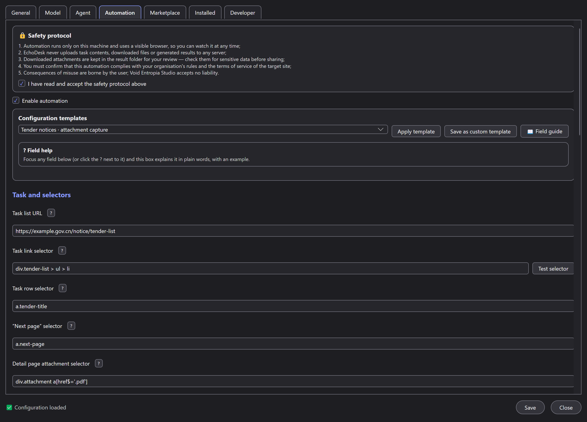

# EchoDesk



**A local, auditable, extensible AI desktop assistant for users working in strictly-controlled environments.**

EchoDesk is a Windows desktop application that keeps the entire AI stack on your own machine:
inference, document parsing, conversation history and browser automation all happen locally.
It is built for people who are not allowed to send their documents to a cloud AI service —
compliance-bound enterprises, network-isolated or air-gapped sites, and anyone who simply
wants their files to stay on the machine.

No cloud account. No API key. No telemetry.

[中文说明 →](README.zh-Hans.md)

| Model marketplace | Browser automation |
| :---: | :---: |
|  |  |

- **Platform**: Windows 10 / 11 (x64), portable folder with a single entry point
- **Inference**: local GGUF models through llama.cpp (`llama-cpp-python`), CPU by default
- **Interface**: C# WPF desktop app, packaged backend written in Python 3.13
- **Languages**: Simplified Chinese and English shipped; more via community language packs
- **License**: [Apache-2.0](LICENSE)

## Why EchoDesk

| Differentiator | What it means in practice |
| --- | --- |
| **Fully local inference** | Prompts, documents, model output and conversation history never leave the machine. The backend loads a local `.gguf` model with llama.cpp; there is no cloud fallback and no hidden upload path. Network access exists only for features you start yourself (model download, web search, skill marketplace, automation). |
| **Reads encrypted WPS/Office documents** | Office documents are parsed through WPS/Office COM first, which is what makes password-protected and legacy `.doc` / `.ppt` files readable — a very common requirement inside enterprises. If WPS/Office is not installed, EchoDesk falls back to its own lightweight parsers for `.docx`, `.xlsx`, `.xlsm`, `.xls`, `.pptx`, `.pdf` and plain text. |
| **Batch web automation, configured visually** | Point EchoDesk at a task-list page, describe the task links, and it walks the list, opens each task, downloads the matching attachments, reviews them with the local model and writes a result file per task. Configuration works through a point-and-click selector picker and per-field help, with a selector test that opens the page and shows what matched before you run anything. |
| **Audit log and safety protocol** | Browser automation requires explicitly accepting a safety protocol; the protocol version and your consent time are written to an audit log. Every automation run is logged (task, time, downloaded file names) with no document text, model output, tokens or cookies. Downloaded files live in a temporary folder and are deleted as soon as the task is processed. |
| **Skill marketplace plus a local plugin interface** | Extend EchoDesk with skills discovered through the GitHub topic `echodesk-plugin`, or load a plugin straight from disk while you develop it — no need to publish first. Skills register commands, UI panels, automation hooks and extra file parsers. |
| **Multi-language** | The interface, system messages, error messages and command help are language-pack driven. Simplified Chinese and English ship today; additional locales are community contributions, with the workflow described under Languages below. |

## Core capabilities

| Capability | Details |
| --- | --- |
| **Local chat** | Streaming answers from a local model, with adjustable temperature, prompt role, per-model profiles and desktop keyboard shortcuts. `/help` lists every command. |
| **Context management** | Default context window 8192 tokens (hard cap 32768), automatically converged to the model's real training window read from GGUF metadata. `/status` reports the window and an fp16 KV-cache estimate. |
| **Long documents** | Documents larger than a fraction of the window are not truncated: they are split, summarized chunk by chunk (map-reduce) and merged, keeping **source pointers** (file name plus character ranges) so answers can be traced back. `/summarize` triggers it manually. |
| **Document formats** | `.docx`, `.xlsx`, `.xlsm`, `.xls`, `.pptx`, `.pdf`, `.txt`, `.md`, `.csv` and similar plain-text formats; `.doc` / `.ppt` and encrypted files via WPS/Office COM. |
| **Model hub** | Search and download GGUF models from a Hugging Face mirror (`hf-mirror.com` by default, switchable to the official endpoint), verify SHA-256, register them in a local model library and hot-swap between them with `/model`. |
| **Browser automation** | Playwright drives the Microsoft Edge already installed on the machine, always in headed mode so you can watch it work. Supports pagination, task de-duplication, per-task download and review, pause-and-wait when a captcha or second factor appears, failure screenshots, batch scheduling and plain-text result files. |
| **Skills** | Install, verify and uninstall skills from the marketplace window (`Ctrl+M`); the marketplace validates `skill.json`, marks unverified skills as non-installable and never auto-executes packaged scripts. |
| **Optional web search** | Off by default. When you switch it on with `/search on`, only the current query keywords are sent to DuckDuckGo. |

## System requirements

| Component | Requirement |
| --- | --- |
| Operating system | The shipped build targets Windows 10 / 11 (x64). Linux and macOS are supported by the cross-platform frontend (Avalonia, `frontend-avalonia/`) with a shared Python backend; the capability differences and degradation rules for those platforms are documented in [docs/en/CROSS_PLATFORM.md](docs/en/CROSS_PLATFORM.md). |
| Frontend runtime | None to install. The Windows frontend is a WPF app (target framework `net10.0-windows`) and the cross-platform frontend is an Avalonia app (target framework `net10.0`); both are published self-contained, so the portable build carries its own runtime. |
| CPU | Any x64 CPU. Inference runs on CPU by default (`n_gpu_layers: 0` in `backend\config.json`). |
| Memory | 4 GB minimum; 8 GB or more recommended. The default model file is about 472 MB, and the KV cache for the default 8192-token window is roughly 0.3–0.4 GB on top of it. Larger context windows and larger models need more. |
| Disk | About 1 GB for the portable folder (roughly 0.85 GB when the model is included, about 0.4 GB without it). Allow 2 GB free while a model is being downloaded. |
| WPS Office or Microsoft Office (optional) | Required for encrypted documents and legacy `.doc` / `.ppt` files, which are read through COM. Without it, use the modern formats listed above. |
| Microsoft Edge (optional) | Required only for browser automation, which drives the locally installed Edge (`channel = msedge`). EchoDesk does not bundle a browser. |
| Network | Optional. Everything except model download, web search, the skill marketplace and automation works offline. |

## Quick start

### Option A — install or unpack a release build (recommended, nothing to build)

1. Get the release from the
   [Releases page](https://github.com/wyx-spark/EchoDesk/releases) of this repository
   (once a release has been published) or by building it yourself with Option B below;
   the build lands in `publish\EchoDesk-v0.2.2\`.
2. Install it or unpack it:
   - **Installer** — double-click `EchoDesk-v0.2.2-Setup.exe` (the single installer; it does **not**
     bundle a model, and asks on first launch whether to download one). By default it installs into the
     folder the installer itself
     sits in; the wizard lets you pick another folder. It creates the Start Menu shortcut, a desktop
     shortcut if you tick that box, and an uninstall entry, so you can remove it from *Apps &
     features* later. The layout it produces is identical to the portable build: the program lives in
     `app\`, your data and `results\` stay in the install folder. Uninstalling also removes the files
     the program created while running (session, models, caches, logs) but **keeps `results\`**.
   - **Portable zip** — unzip anywhere: desktop, another drive, even a USB stick. Nothing is written
     outside that folder, and deleting the folder uninstalls it.

   > **Note:** EchoDesk is not currently signed with a commercial code-signing certificate, and
   > Windows may show an "Unknown publisher" warning. This is normal for open-source projects —
   > click **More info** → **Run anyway**. Our signing policy is documented in
   > [CODE_SIGNING.md](CODE_SIGNING.md).

3. Start EchoDesk: use the **Start Menu shortcut** (installer), or double-click
   **`Start-EchoDesk-v0.2.2.lnk`** inside the folder (portable zip — run `install-complete.bat`
   once if that shortcut is missing). Either shortcut points at *your* copy of the program.
   Whichever route you took, that shortcut is the only entry point you need;
   `app\EchoDesk.exe` is the UI and `app\backend\EchoDeskBackend.exe` is started automatically —
   never launch the backend by hand.
4. On first launch, answer the model question described below, then start typing.
   Useful first commands: `/help`, `/file <path>`, `/model list`, `/status`.

Keyboard shortcuts worth knowing: `Ctrl+Enter` send, `Esc` stop generation, `Ctrl+O` upload a
file, `Ctrl+L` clear the conversation, `Ctrl+,` settings, `Ctrl+M` skill marketplace.

### Option B — build from source

Requirements: Python 3.13 (backend) and a .NET SDK able to build the project's target framework
`net10.0-windows` (frontend).

```powershell
# 1) Backend dependencies (Python 3.13; the pinned set lives in requirements.txt)
python -m venv .venv
.\.venv\Scripts\Activate.ps1
python -m pip install -r backend\requirements.txt

# 2) Frontend
dotnet build frontend\EchoDesk.csproj -c Release

# 3) Tests - they do not need a model file
python tools\selftest.py            # backend unit-level self-test, exit code 0/1
python tools\test_file_parsers.py   # smoke test for every supported file format

# 4) Full portable build -> publish\EchoDesk-v0.2.2\
& tools\build_release.ps1
& tools\build_release.ps1 -SkipBackend     # rebuild only the WPF frontend
& tools\build_release.ps1 -SkipFrontend    # rebuild only the packaged backend
& tools\build_release.ps1 -IncludeModels   # include local .gguf models (offline bundle)
```

The WPF frontend talks to the **packaged** backend executable, so a frontend-only development
loop needs that executable once. Build it and point the app at it with the `ECHODESK_BACKEND`
environment variable:

```powershell
# Build the backend with PyInstaller (product: dist\EchoDeskBackend\EchoDeskBackend.exe)
pyinstaller --noconfirm --distpath dist --workpath build\pyi backend\EchoBackend.spec

# Run the frontend from source against it
$env:ECHODESK_BACKEND = "$PWD\dist\EchoDeskBackend\EchoDeskBackend.exe"
dotnet run --project frontend\EchoDesk.csproj
```

The backend can also be started on its own (`python backend\main.py`): it speaks a JSON-per-line
protocol over stdin/stdout, documented in [docs/DEVELOPER.md](docs/DEVELOPER.md). Place a `.gguf`
model in `backend\models\` (source runs) or in the packaged backend's `models\` folder.

### First launch: no model yet? The app still runs

EchoDesk does **not** ship model weights and never downloads anything silently:

1. On start, the backend checks for the model named in `backend\config.json`
   (default `Qwen3-0.6B-Q6_K.gguf`, about 472 MB).
2. If the file is missing, the backend **keeps running** in a "no model yet" state: it reports
   `need_download` (with `blocking: false`) and a `ready` message carrying `model_ready: false`
   plus guidance. The UI stays interactive — you can browse settings, parse files and open the
   model market. Nothing is downloaded without your explicit action.
3. Three ways to get a model, none of which requires restarting the app:
   * **Model market** — Settings → Model → Model market. It lists **all** GGUF repositories
     (nothing is hidden by hardware filtering); entries that fit this machine are marked
     `(Recommended)` and the repository of the configured default model is pinned first.
   * **Manual copy** — drop any `.gguf` file into `app\backend\models\` and click
     *Rescan models folder*; if exactly one model is found it is loaded automatically.
   * **Load** — click *Load* next to an already-downloaded model in the local model library.
4. A download or a load **hot-loads the model**: the status bar switches from "no model" to the
   model name and inference starts working, with no restart of the backend or the UI. If loading
   fails (corrupt file, unsupported format, not enough memory) the app stays in the no-model
   state, shows the reason and lets you retry.
5. Downloading uses the configured Hugging Face endpoint — `https://hf-mirror.com` by default,
   which you can point at the official `https://huggingface.co` or an internal mirror by editing
   `hf_endpoint` / `model_repo` / `model_path` in `backend\config.json`.
6. If no launcher shortcut exists in the folder, EchoDesk asks once whether to create one, and
   then shows a short first-run guide. Per-machine settings can be kept out of version control by
   putting them in `app\backend\config.user.json`, which takes precedence over `config.json`.

### What is inside the portable folder

The portable build separates the program from your data: everything you may want to edit, back up
or move lives in the outer folder, while the program itself sits in `app\`.

| Path | Contents |
| --- | --- |
| `Start-EchoDesk-v0.2.2.lnk` | The only entry point (targets `app\EchoDesk.exe`, working directory = this folder). |
| `results\` | Automation output (`date\task\` folders with plain-text reports and downloaded files). |
| `ui_state.json`, `snippets.json` | Window state, font size, theme, language and reusable snippets. |
| `lang\` | Backend language packs (system messages, errors, command help). Drop in a new `<locale>.json` to add a language. |
| `examples\skills\` | Example plugin sources (Hello World and an OFD reader). |
| `docs\` | Documentation shipped with the release (`docs\zh-Hans\`, `docs\en\`), plus privacy policy, EULA and third-party licences. |
| `LICENSE`, `NOTICE`, `SECURITY.md` | Licence, attribution and security policy. |
| `app\EchoDesk.exe` | WPF frontend; its .NET dependencies are DLLs next to it. |
| `app\lang\ui\` | UI language packs (labels, buttons, dialogs). |
| `app\backend\EchoDeskBackend.exe` | Packaged Python backend (PyInstaller onedir), dependencies in `app\backend\_internal\`. |
| `app\backend\config.json` | All configuration: model, context window, summarization, automation, marketplace, model hub. |
| `app\backend\models\` | Local `.gguf` models. |
| `app\backend\session.json` | Conversation history (auto-saved and restored). |

Set the `ECHODESK_DATA` environment variable to move the outer data folder somewhere else (useful
on managed machines where the program folder itself is read-only).

## Screenshots and demo

Screenshots are **not part of the v0.2.2 release**. The only image assets that ship today are
`assets/EchoDesk.ico` (the application icon) and `assets/EchoDesk.png` (the logo). Nothing in
this README links to an image that does not exist yet.

Interface previews — the main window, long-document summarization, the automation tab with the
selector test, a headed automation run and the skill marketplace in both languages — will be
added to `assets/screenshots/` in a future update, and this section will embed them then.

Until they arrive, the quickest way to see the interface is to run the portable build: it needs
no installation, no cloud account and no network for local chat (see
[Quick start](#quick-start)).

## Languages

EchoDesk is designed for global users, and localization is part of the product rather than an
afterthought:

- **Shipped today**: Simplified Chinese (`zh-Hans`) and English (`en`).
- **Language packs**: `backend/lang/<locale>.json` for backend messages, error texts and command
  help; `frontend/Resources/Lang/<locale>.json` for UI strings. Documentation lives under
  `docs/<locale>/`. Each entry uses a semantic key such as `settings.automation.task_url.label`
  and may carry a comment describing its context and placeholders.
- **Automatic detection**: `language` defaults to `auto`, so the first start follows the system
  locale; you can also pick a language in Settings, and the choice is remembered.
- **Fallback chain**: `requested locale → en → zh-Hans → the key itself`. Returning the key makes
  missing translations obvious instead of silently showing blanks.
- **Community locales**: `zh-Hant`, `ja`, `ko`, `de`, `fr`, `es` and `pt-BR` are the next
  candidates, and any locale is accepted. The workflow is: copy `backend/lang/en.json` and
  `frontend/Resources/Lang/en.*.json` to the target locale code, translate the values while
  keeping the keys, run `python tools/check_lang.py` to confirm the key set matches English,
  then add the matching document translation under `docs/`.

## Extending EchoDesk: skills and local plugins

EchoDesk is extensible in two ways, and both use the same runtime interface:

- **Skill marketplace** — open it with `Ctrl+M`. Skills are discovered through the GitHub topic
  `echodesk-plugin`; a repository is *verified* when its root contains a `skill.json` with an
  `echodesk.bundle` entry. Unverified repositories cannot be installed, packaged `prepare`
  scripts are never executed automatically, and the marketplace caches results so an offline or
  rate-limited GitHub API degrades gracefully.
- **Local plugin interface** — point EchoDesk at a plugin folder on disk and it is discovered and
  loaded like a marketplace skill, with no GitHub round-trip. A development directory
  (`backend\skills_dev\`) is the intended place for work in progress; check the skill guide for
  the current layout and API surface.

Start here:

- [Skill development guide (Chinese)](docs/zh-Hans/SKILL_GUIDE.md) — manifest format, capabilities,
  security review rules, publishing steps.
- [docs/en/SKILL_GUIDE.md](docs/en/SKILL_GUIDE.md) and
  [docs/zh-Hans/SKILL_GUIDE.md](docs/zh-Hans/SKILL_GUIDE.md) — localized versions of that guide
  (added as part of the v0.2.1 documentation set).
- [docs/DEVELOPER.md](docs/DEVELOPER.md) — architecture, the stdin/stdout protocol, module map
  and extension points for commands, protocol actions and file formats.

## Privacy, audit and compliance

EchoDesk is local by design, and the policy is written down rather than implied:

- **Always local**: chat and inference, file parsing, long-document summarization, conversation
  history, snippets and UI state, and the browser actions performed by automation.
- **Network only on request**: model download (you confirm it), web search (`/search on`),
  skill marketplace queries against the GitHub API, and automation requests to the site you
  configured yourself.
- **No telemetry**: no analytics, tracking, usage statistics or crash reporting of any kind.
- **Audited automation**: the safety protocol must be accepted before automation can be enabled;
  the protocol version and consent time go into `backend\automation_log.jsonl`, which records
  what ran and which files were downloaded — file names only, never document text, model output,
  tokens, cookies or passwords.
- **Data you control**: delete `backend\session.json`, `snippets.json`, `ui_state.json`,
  `backend\models\*.gguf` or `backend\browser_state.json` at any time to remove history,
  preferences, models or stored browser sessions. Read [docs/PRIVACY.md](docs/PRIVACY.md) for the
  itemized breakdown, and [docs/EULA.md](docs/EULA.md) for the usage terms — including the point
  that model output from a small local model can be wrong and is not professional advice.

## Documentation

| Document | Contents |
| --- | --- |
| [docs/en/USER_GUIDE.md](docs/en/USER_GUIDE.md) | End-user manual: install, daily use, long contracts, batch automation, skills. |
| [docs/en/CROSS_PLATFORM.md](docs/en/CROSS_PLATFORM.md) | Platform support and capability boundaries: the three-platform matrix, the two degradation boundaries with their alternatives, platform reporting, directories and environment variables, packaging and signing, and the verification evidence. |
| [docs/en/FAQ.md](docs/en/FAQ.md) | Quick answers and troubleshooting for startup, models, files, automation and the marketplace. |
| [docs/en/AUTOMATION_GUIDE.md](docs/en/AUTOMATION_GUIDE.md) | Field-by-field automation configuration and the selector test. |
| [docs/DEVELOPER.md](docs/DEVELOPER.md) | Architecture, JSON protocol, module responsibilities, config reference, build and release. A pointer: the full text is [`docs/en/DEVELOPER.md`](docs/en/DEVELOPER.md) (English) and [`docs/zh-Hans/DEVELOPER.md`](docs/zh-Hans/DEVELOPER.md) (Simplified Chinese). |
| [docs/en/SKILL_GUIDE.md](docs/en/SKILL_GUIDE.md) | How to write, submit and publish a skill. |
| [docs/PRIVACY.md](docs/PRIVACY.md) | What runs locally, what may go online, log redaction rules. |
| [docs/EULA.md](docs/EULA.md) | End-user license terms for the distributed build. |
| [docs/ENCRYPTED_DOCUMENTS.md](docs/ENCRYPTED_DOCUMENTS.md) | How EchoDesk reads documents protected by an enterprise encryption system: prerequisites, the no-circumvention statement, where responsibility lies, and what stays in memory. |
| [docs/THIRD_PARTY_LICENSES.md](docs/THIRD_PARTY_LICENSES.md) | Complete third-party component and license inventory. |
| [CHANGELOG.md](CHANGELOG.md) | Feature, fix and known-limitation history per version (English; Chinese at [CHANGELOG.zh-Hans.md](CHANGELOG.zh-Hans.md)). |
| [CONTRIBUTING.md](CONTRIBUTING.md) | How to file issues, contribute code, and contribute translations (English; Chinese at [CONTRIBUTING.zh-Hans.md](CONTRIBUTING.zh-Hans.md)). |
| [NOTICE](NOTICE) | Attribution notice for the main bundled third-party components. |

Localized documents exist in both shipped languages: `docs/en/` (English, linked above) and
`docs/zh-Hans/` (Simplified Chinese, the same set of guides).

## Getting help and contributing

Contributions are welcome — bug reports, fixes, skills, translations and documentation alike.
Every public channel is on GitHub; the project publishes **no support email address, no phone
number and no postal address**.

- **Report a problem or request a feature** — report problems by opening a GitHub Issue:
  <https://github.com/wyx-spark/EchoDesk/issues>. Bug reports, feature requests, skill
  submissions and translation help each have a template; include your version, operating system,
  exact steps and the relevant log.
- **Ask a question, share a skill, coordinate a translation** — start a thread in
  [GitHub Discussions](https://github.com/wyx-spark/EchoDesk/discussions).
- **Send a change** — open a pull request; [CONTRIBUTING.md](CONTRIBUTING.md) covers the
  development environment, code style, commit conventions and the review flow. See
  [SECURITY.md](SECURITY.md) for log locations.
- **Security problems** — please do **not** open a public issue; follow the private reporting
  process in [SECURITY.md](SECURITY.md) instead (supported versions, what to include and our
  response-time commitment are documented there too).
- **Community behaviour** — [CODE_OF_CONDUCT.md](CODE_OF_CONDUCT.md).

## License

EchoDesk is released under the **Apache License 2.0**, whose full text ships with the repository
and with every release as `LICENSE`. The license includes an explicit patent grant and permits
commercial and enterprise use, modification and redistribution, which is why it was chosen over a
shorter permissive license.

- Attribution for the main bundled third-party components: [NOTICE](NOTICE).
- Full component and license inventory: [docs/THIRD_PARTY_LICENSES.md](docs/THIRD_PARTY_LICENSES.md).
- Model weights are **not** part of the project and remain under the license chosen by their
  publisher; confirm the terms of the model you download.
- Code signing policy: [Code Signing Policy](CODE_SIGNING.md).
- Copyright 2026 Void Entropia Studio.
