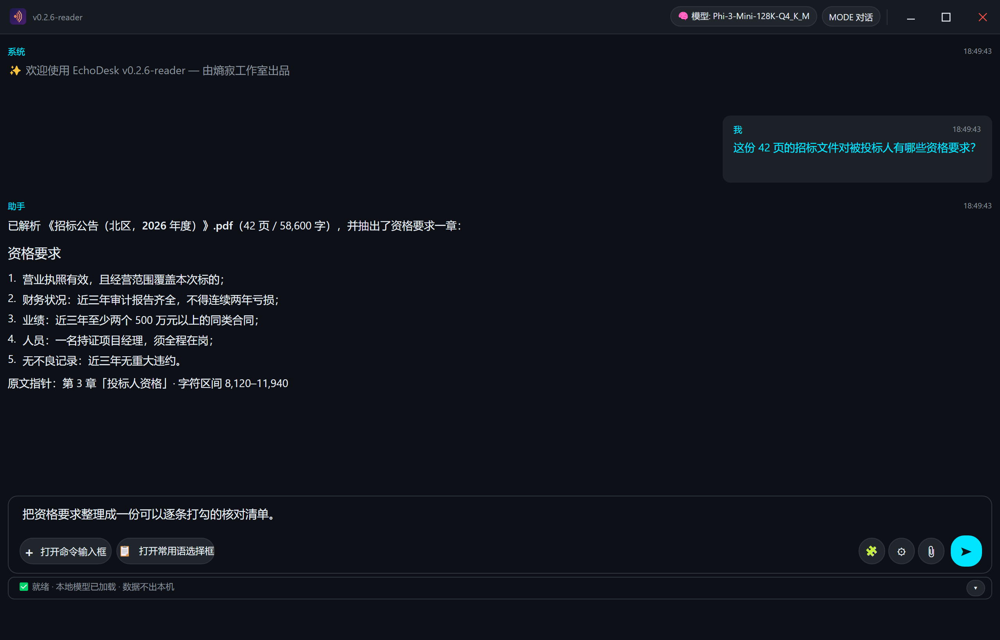
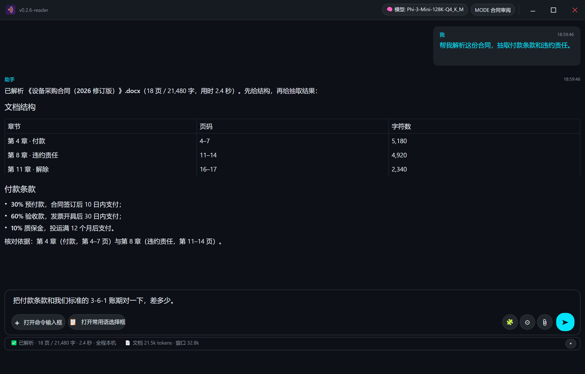
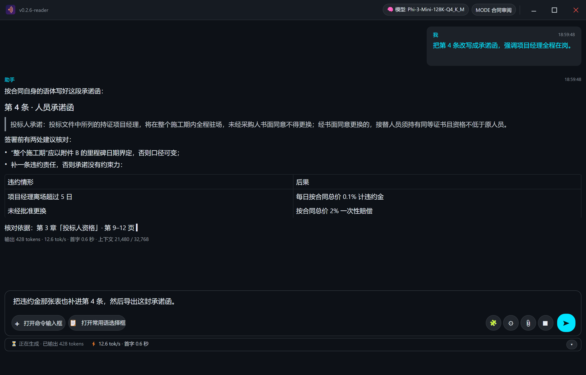

# EchoDesk Reader

[](https://github.com/wyx-spark/EchoDesk/actions/workflows/ci.yml) [](https://github.com/wyx-spark/EchoDesk/releases/tag/v0.2.6-reader)

> **版本 0.2.6-reader。** 本分支发布 Reader 版：在 v0.2.6 代码基上移除浏览器自动化、多模态与检索栈，
> 专注于阅读与分析本机的长篇文档。下面每一句关于功能的描述都适用于**这一个**构建；被移除的部分在
> [本版不包含什么](#本版不包含什么) 里逐项列出。
>
> **该用哪个版本？** `master` 是完整版 EchoDesk（浏览器自动化、多模态、检索栈）；`reader`（本分支）是长篇文档阅读版，其构建在 [Releases 页面](https://github.com/wyx-spark/EchoDesk/releases) 上的标签是 `v0.2.6-reader`；当前 Latest 发布属于 `master`。两个分支版本号相同。
>
> **第一次使用？** 请按 [下载、安装与配置指南（Issue #7）](https://github.com/wyx-spark/EchoDesk/issues/7) 逐步操作：选版本、核对 SHA-256、使用离线模型包、完成首次配置。



**本地优先的文档阅读与分析助手 —— 不联网、不要账号、没有遥测。**

EchoDesk Reader 把整条链路留在你的机器上：模型经 llama.cpp 在本机推理，文档在本机解析，对话记录
不出磁盘。它面向的是**不能把合同与报告发给云端 AI** 的人 —— 受合规约束的团队、隔离网络，以及单纯
希望文件留在本地的用户。

[English →](README.md)（本文为英文版的中文参考译本，如两者有歧义，**以英文版为准**。）

| 解析完成的文档 | 正在流式输出的合同改写 |
| :---: | :---: |
|  |  |

- **平台**：Windows 10/11（x64）优先；同一套 Avalonia 前端可在 macOS 与 Linux 上构建与运行。
  WPF 前端仍留在仓库里服务 Windows 长期支持线，但**不参与** Reader 的构建。
- **推理**：本地 GGUF 模型，经**原生 llama.cpp 运行期** —— Python 的 `llama-cpp-python` 绑定已
  物理移除，由 `backend/llama_native.py` 直接调用 C ABI，默认走 CPU
- **模型画像**：任意 GGUF 模型均可加载；文档分配以所选模型自身上下文上限为界，并可在 **设置 → 上下文** 中选择 32K–256K / 模型硬上限 / 自定义，无需修改配置文件
- **KV 缓存**：量化为 8 位（`Q8_0`）而非 F16，同一窗口下缓存占用约减半
- **界面**：Avalonia（C#）桌面程序 + Python 3.13 打包后端
- **语言**：简体中文与英语
- **许可证**：[Apache-2.0](LICENSE)

## 零联网：一项可核查的承诺

**本版本不会发出任何联网请求，且已筛查源码确认不存在任何请求 API 的代码。** 没有模型下载器、没有
模型市场、没有更新检查、没有遥测、没有外部 Provider 路由，也不启动本地 HTTP 服务。模型是用户自行
放入模型目录的 `.gguf` 文件（如需下载，可在浏览器中前往 GitHub Release 页面）；打开该页面是界面
唯一能触发的浏览器跳转，且必须由用户明确点击。

界面里的模型区域只是静态引导：告诉你去哪里获取 GGUF，并重新扫描本地模型目录；不会下载任何东西。

该承诺由 `python tools/audit_network.py` 强制执行：它扫描后端的全部 Python 源码与 Avalonia 的
全部 C# 源码，发现任何对外网络 API 即判定失败。依赖锁（`backend/requirements.lock`）中不含任何
HTTP 客户端、模型仓库客户端或推理轮子。

## 动态上下文：本版存在的理由

Reader 的上下文窗口**按文档分配，而不是按固定设置**：文件解析完成后，窗口按

```
文档 tokens + 4096（回答预算）+ 512（安全余量）
```

规划在 `[初始窗口, 已配置上限]` 之间，只有窗口需要变大时才重建模型。同一进程内窗口只增不减，因此
再加一份更小的文档不会为更小的数值重载一次模型。

上限不再是固定的 128K：`inference_config.json` 的 `n_ctx_max` 可写，**设置 → 上下文** 把它做成
六个档位（32K / 64K / 128K / 256K / 模型硬上限 / 自定义）。窗口超过模型自带能力时会自动启用原生
RoPE 缩放；模型文件已自带缩放时绝不叠加（叠加会让长文输出变成乱码）。仍然装不下的文档会被
**拒绝并说明原因，绝不做静默截断** —— 你始终知道某个文件为什么没被接受。

## 本版不包含什么

下列能力属于上游 v0.2.6，**在本构建中被整体移除**（连同它们的设置页、测试与打包步骤）：

| 已移除 | 原先的用途 |
| --- | --- |
| 浏览器自动化 | Playwright 驱动的任务清单批量处理（选择器向导、安全协议、结果文件） |
| 多模态 | 本地视觉（VLM）、录音与转写、媒体路径管控 |
| 检索栈 | SQLite FTS5 知识库、长期记忆、BM25 检索与抽取式摘要器 |

本分支的 `tools/verify_release.ps1` 会断言这些模块没有任何残留被导入或被打包，而不是去检查它们。

## 快速上手

### 该下哪个文件？

| 你的情况 | 下载 |
| --- | --- |
| Windows，要安装程序 | `EchoDesk-Reader-v0.2.6-Setup.exe` |
| Windows，要免安装文件夹 | `EchoDesk-v0.2.6-reader-win-x64.zip` |
| Linux x64 | `EchoDesk-v0.2.6-reader-linux-x64.tar.gz` |
| macOS Apple Silicon | `EchoDesk-v0.2.6-reader-osx-arm64.tar.gz` |
| 任何平台，还没有模型 | `models-qwen-v1` 发布（Q4_K_M 的 GGUF 模型包） |

### 便携版（无需安装）

1. 把 `EchoDesk-v0.2.6-reader-win-x64` 整个文件夹解压到任意位置 —— 不往文件夹外写任何东西，
   删掉文件夹即完成卸载。
2. 双击 **`app\EchoDesk.exe`**。它会自己启动旁边的后端；**不要**单独运行
   `app\backend\EchoDeskBackend.exe`，它只会说 JSON 行协议。
3. 本版**不下载模型**。请到 [Releases 页面](https://github.com/wyx-spark/EchoDesk/releases) 获取
   GGUF（`models-qwen-v1` 发布里打包了若干模型），放进 `app\backend\models\`，再到
   **设置 → 模型** 里选中它；界面里的模型区域只给这条引导，并重新扫描目录。

目录结构：

| 路径 | 是什么 |
| --- | --- |
| `README.md`、`LICENSE`、`NOTICE` | 本文与许可证 |
| `app\EchoDesk.exe` | Avalonia 前端；界面语言包已内嵌其中 |
| `app\backend\EchoDeskBackend.exe` | 打包后的 Python 后端（PyInstaller onedir） |
| `app\backend\lang\` | 后端语言包（消息、错误、指令帮助） |
| `app\backend\config.json` | 全部配置 |
| `app\backend\models\` | 本地 `.gguf` 模型 |
| `app\backend\session.json` | 对话记录（自动保存与恢复） |

可选的 `-MakeInstaller` 步骤会产出 `EchoDesk-Reader-v0.2.6-Setup.exe`，装出来的目录结构与此相同。

设置环境变量 `ECHODESK_DATA` 可以把外层数据目录挪到别处（适用于程序目录只读的被管机器）。

### 从源码运行

```
python -m venv .venv
.venv\Scripts\python -m pip install -r backend\requirements.lock
dotnet run --project frontend-avalonia\EchoDesk.Avalonia\EchoDesk.Avalonia.csproj
```

后端由前端自行拉起。若要单独试协议，请**把 `backend\` 作为工作目录**运行 `python backend\main.py`
（后端按工作目录解析 `models/` 与技能目录），然后逐行输入 JSON 请求。macOS/Linux 上把
`python`/`.venv\Scripts` 换成 `python3`/`.venv/bin`。`tools/build_reader.ps1` 产出 Windows
便携目录，加上 `-MakeInstaller` 还会产出 Inno Setup 安装包。

## 能读哪些文档

`.docx`、`.xlsx`、`.xlsm`、`.xls`、`.pptx`、`.pdf`、`.txt`、`.md`、`.csv` 以及类似的纯文本格式。
Windows 上，旧式 `.doc` / `.ppt` 与加密文档借本机已授权的 WPS/Office COM 读取；没有 WPS/Office 时，
内置解析器仍能处理现代格式，旧式格式会明确报告不可用，而不是静默失败。

长文档**整篇读入而不是压缩**：窗口会按文档扩张（见
[动态上下文：本版存在的理由](#动态上下文本版存在的理由)），解析后的正文一次交给模型。本分支刻意
**不做**逐段摘要 —— 那条链路要靠小模型压缩材料，而压缩恰恰是"具体条款答不准"的根因。连当前
上限都装不下的文档会被拒绝并说明原因，绝不静默丢弃内容。

## 隐私与联网

- 没有遥测、没有账号、不监听任何端口，也**没有任何联网功能**：本构建无法把文档发送到任何地方。
- **已整体移除**：联网搜索、模型下载、更新检查与外部模型服务。本构建里不存在执行它们的代码路径，
  这一点由 `tools/audit_network.py` 强制执行。

## 文档

- [`docs/zh-Hans/USER_GUIDE.md`](docs/zh-Hans/USER_GUIDE.md) —— 使用手册，含 Reader 版的范围说明。
- [`docs/zh-Hans/FAQ.md`](docs/zh-Hans/FAQ.md) —— 快速上手与排障。
- [`docs/zh-Hans/CROSS_PLATFORM.md`](docs/zh-Hans/CROSS_PLATFORM.md) —— 各平台的差异。
- [`CHANGELOG.zh-Hans.md`](CHANGELOG.zh-Hans.md) —— 版本历史。
- [`SECURITY.zh-Hans.md`](SECURITY.zh-Hans.md) —— 如何私下报告安全问题。
- [`docs/images/`](docs/images/) —— 上面内嵌的截图；重新生成的步骤见
  [`docs/zh-Hans/DEVELOPER.md`](docs/zh-Hans/DEVELOPER.md)。

## 获取帮助与参与贡献

欢迎各种形式的贡献——缺陷报告、代码修复、技能、翻译与文档都算。所有公开渠道都在 GitHub 上：
本项目**不提供**支持邮箱、电话或邮寄地址。

- **反馈问题或提功能请求** —— 请开 GitHub Issue：
  <https://github.com/wyx-spark/EchoDesk/issues>。请写明版本、操作系统、复现步骤与相关日志。
- **提问或分享想法** —— 到
  [GitHub Discussions](https://github.com/wyx-spark/EchoDesk/discussions) 发帖。
- **提交改动** —— 开 Pull Request；开发环境、代码风格、提交约定与评审流程见
  [CONTRIBUTING.zh-Hans.md](CONTRIBUTING.zh-Hans.md)。
- **安全问题** —— 请**不要**开公开 Issue，按 [SECURITY.zh-Hans.md](SECURITY.zh-Hans.md)
  里的私下报告流程处理。
- **社区行为** —— [CODE_OF_CONDUCT.zh-Hans.md](CODE_OF_CONDUCT.zh-Hans.md)。

## 出品方

[Void-Entropia-Studio](https://github.com/Void-Entropia-Studio)。EchoDesk 是独立项目，与任何使用相同
或相似名称的产品都没有关联。
